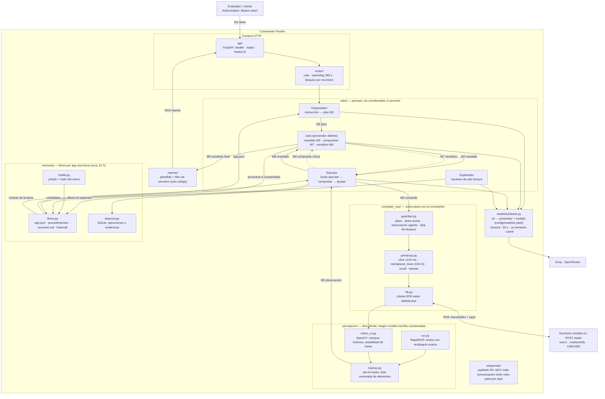
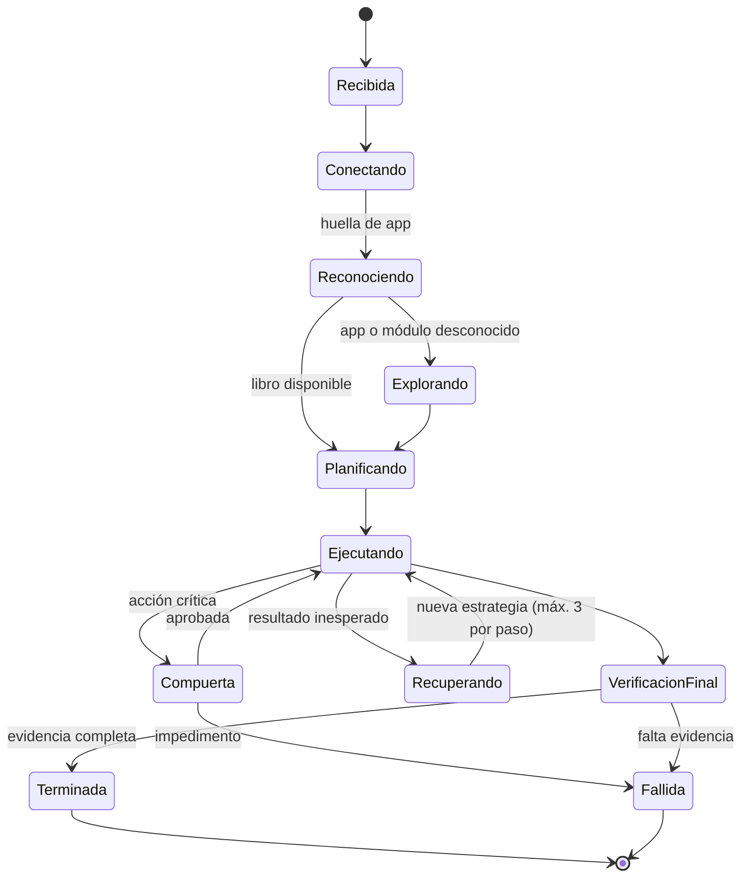
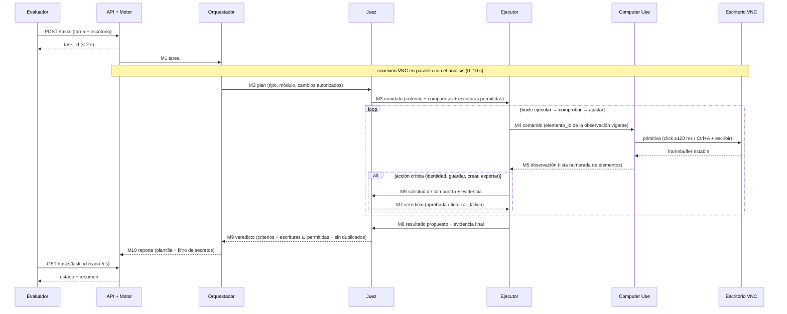
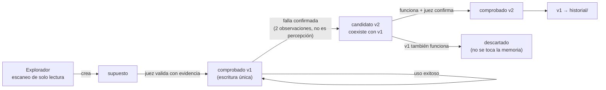
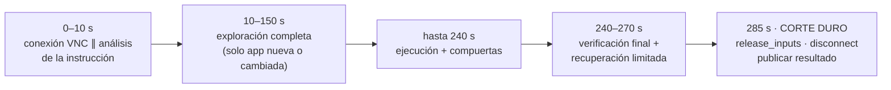

# SmartRookie · Diagramas de arquitectura

> Vistas completas del sistema. GitHub renderiza mermaid directamente; en local se pueden ver con
> la extensión de mermaid de VS Code o en [mermaid.live](https://mermaid.live).
> Diseño detrás de cada vista: [`README.md`](README.md) y [`DISENO-ROOKIE.md`](DISENO-ROOKIE.md).

---

## 1. Vista de componentes (completa)

Cada subgrafo es un paquete real del repositorio (§14). Las fronteras importan: `computer_use/` es
la única pieza que conoce la contraseña del escritorio, y los roles solo hablan por esquemas
tipados — nunca ven coordenadas ni secretos.

**Lectura del diagrama:**

- Flechas sólidas = flujo normal de una tarea (M1 → … → M10).
- Flechas punteadas = compuertas: antes de guardar, crear, exportar, eliminar o confirmar
  identidad, el ejecutor pide veredicto al juez (D1: segunda comprobación independiente).
- La contraseña entra por `POST /tasks` y muere en `rfb.py`; el resto del sistema usa
  `escritorio_ref`.

---

## 2. Máquina de estados de una tarea

Desde cualquier estado activo, el plazo (285 s) o la cancelación llevan al cierre: soltar entradas,
desconectar, publicar resultado, bloquear nuevos comandos.

---

## 3. Secuencia de una tarea (contrato M1–M10)

---

## 4. Ciclo de vida de la memoria (libros)

| Actor | Permisos |
|---|---|
| Explorador | Crear `supuesto`; nunca promover |
| Ejecutor | Detectar fallas confirmadas y proponer `candidato` |
| Juez | **Único** que promueve a `comprobado` e invalida |
| Código | Criterio de tres condiciones, escritura atómica, historial |

---

## 5. Presupuesto de tiempo de una tarea (5 min)

Con libro disponible, la fase de exploración se salta y la ejecución empieza de inmediato: la
primera tarea de una app paga la exploración, las siguientes la amortizan.
