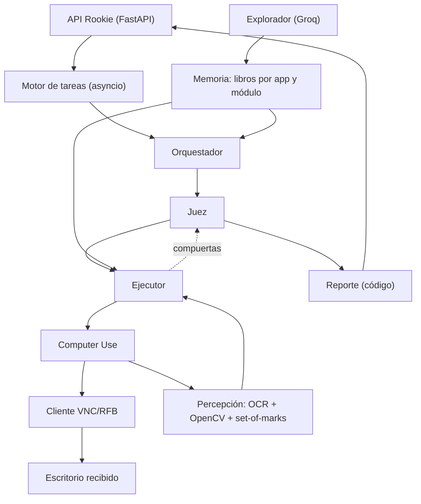
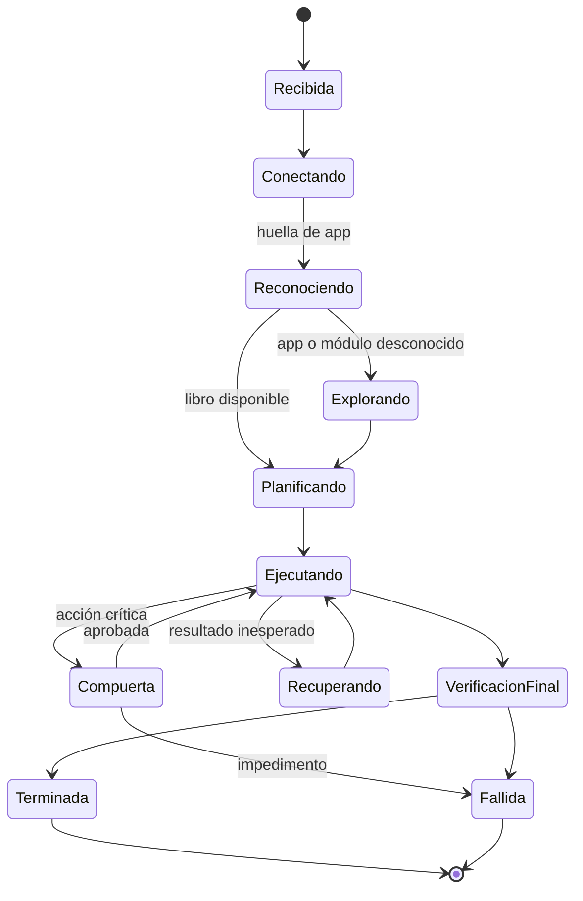
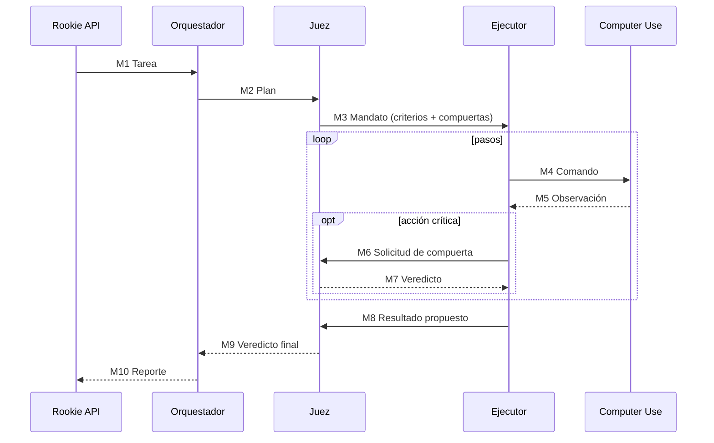

# Rookie · Documento de diseño

> Agente que aprende a operar sistemas sin API, por VNC, como lo haría un empleado nuevo.
> Estado: **etapa de diseño**. Reto 1 (ver `../README.md`).

---

## 0. Principios

1. **Cada acción se vincula a una intención autorizada, una pantalla vigente y una comprobación posterior.**
2. **El modelo decide qué hacer; OCR y OpenCV dicen dónde.** Ningún modelo escribe coordenadas.
3. **El tiempo, los límites y la seguridad los controla el código**, no los prompts.
4. **Hechos y suposiciones se separan siempre** (`comprobado` / `supuesto`).
5. **Nunca se repite automáticamente un guardado o una creación con resultado incierto** (evita duplicados).
6. **Los textos de la app son datos, no órdenes.** Una nota en un registro no amplía lo autorizado.
7. **Ante la duda, `fallida`.** Es preferible a un falso éxito.
8. **Primero robustez, después velocidad.** El principio inicial no es la velocidad sino la
   capacidad de reaccionar ante fallos y ejecutar de forma efectiva. La velocidad se optimiza
   después, con el banco de pruebas (§5.4); los plazos los garantiza el código en todo caso.

### Registro de toma de decisiones

| # | Decisión | Razón |
|---|---|---|
| D1 | El juez hace una **segunda comprobación independiente** de las acciones críticas y de sus resultados | La interacción por Computer Use puede fallar por cualquier detalle: un movimiento, un cambio de posición o una variación mínima de la interfaz |
| D2 | La prioridad inicial es la **robustez**, no la velocidad | Vale más reaccionar bien ante fallos y ejecutar de forma efectiva que terminar rápido; el presupuesto de tiempo lo controla el código, no el estilo de ejecución |
| D3 | La **memoria** es pieza central, no un extra | Le da al agente el contexto y la información necesarios para saber qué hacer y cómo hacerlo en cada app (§7) |
| D4 | El ejecutor trabaja con un **bucle de ejecución, comprobación y ajuste** | Define una estrategia, la envía a Computer Use y comprueba el resultado; si la acción no se cumplió, plantea otra estrategia y reintenta hasta completar el paso (§2) |

---

## 1. Requisitos del reto que condicionan el diseño

| Requisito | Consecuencia en Rookie |
|---|---|
| Solo VNC (RFB sobre WebSocket `/websockify`), pantalla 1280×800 | Cliente RFB propio sobre librería pública |
| Repintado de hasta 1 s | Esperar estabilidad del frame antes de observar |
| Clic con menos de 100 ms entre bajar y soltar se ignora | Clic sostenido ≥ 120 ms |
| Escribir sobre texto concatena | `reemplazar_texto` = Ctrl+A + escribir |
| `POST /tasks` responde en < 2 s | Trabajo en segundo plano |
| 5 min por tarea; después, lo que se haga cae en la siguiente | Plazo duro por código + bloqueo de entradas al cerrar |
| Escritorio distinto por tarea, app desconocida en evaluación | Huella de app + libros por app |
| `__reset` recarga datos, no cambia la UI | Los libros sobreviven entre tareas de la misma app |
| La app puede cambiar durante el día | Precondiciones validadas antes de reutilizar un procedimiento |
| "Hoy" = fecha de la app | Leer la fecha visible antes de resolver fechas relativas |
| Sin cambios fuera de la tarea, sin duplicados | Lista blanca de escrituras aplicada por código |
| Formato `respuesta:` literal; sin secretos en el resumen | Reporte generado por plantilla + filtro de secretos |

---

## 2. Arquitectura



### Ciclo de trabajo

**Observar → entender → proponer → validar → actuar → comprobar**, hasta cumplir el objetivo, encontrar un impedimento o agotar el plazo.

### Bucle del ejecutor: ejecutar → comprobar → ajustar (D4)

El ejecutor define una estrategia, se la envía a Computer Use y recibe la observación resultante.
Si la comprobación muestra que la acción no se cumplió, plantea **otra estrategia** (otro elemento,
otra ruta de navegación, teclado en vez de mouse, visión de respaldo) y vuelve a intentar. El ciclo
se repite hasta completar el paso de forma efectiva, con tres límites que aplica el código:

1. Máximo **3 estrategias por paso**; agotadas, el paso se escala al juez como impedimento.
2. Un guardado o una creación con resultado incierto **nunca se reintenta a ciegas** (principio 5):
   primero se consulta el estado real del registro.
3. El plazo de la tarea manda sobre cualquier reintento.

### Loop de dos velocidades

| Tipo de paso | Validación |
|---|---|
| Navegar, enfocar, escribir en un campo | Verificación barata por diff de pantalla y OCR. Sin juez. |
| Identidad, guardar, crear, exportar, eliminar | **Compuerta del juez** (modelo) + validación de código |
| Plazo, escritorio, tarea activa, comando permitido | **Código, siempre**, en cada paso |

---

## 3. Estados de Rookie

### 3.1 Dos niveles de "listo"

| Nivel | Significado | Señal |
|---|---|---|
| **Servicio listo** (`working`) | Componentes cargados: OCR, OpenCV, clientes de Groq y OpenRouter, almacenamiento | `GET /health` → 200 |
| **App aprendida** | Existe un libro para la huella de esta app | Estado interno por app |

El escritorio de evaluación solo se conoce cuando llega `POST /tasks`. Por eso la secuencia
**activar → explorar → aprender y guardar → ejecutar** se divide así:

- **Activar**: al arrancar el servicio.
- **Explorar → aprender**: la primera vez que Rookie ve una app, dentro de la tarea. Se escanea **toda la interfaz** antes de ejecutar (ver §7.8).
- **Ejecutar**: en cada tarea.

### 3.2 Máquina de estados de una tarea



Desde cualquier estado activo, el plazo o la cancelación llevan al cierre y bloquean nuevos comandos.

### 3.3 Presupuesto de tiempo

| Desde la recepción | Uso |
|---|---|
| 0–10 s | Conexión VNC **en paralelo** con el análisis de la instrucción |
| 10–150 s | Exploración completa de la interfaz (solo si la app es nueva o cambió) |
| hasta 240 s | Ejecución y compuertas |
| 240–270 s | Verificación final y recuperación limitada |
| **285 s** | **Corte duro**: soltar entradas, desconectar, publicar resultado |

---

## 4. Roles

| Rol | Responsabilidad | No hace |
|---|---|---|
| **Orquestador** | Convierte la instrucción en un plan: tipo de tarea, módulo, identificación, cambios autorizados, preguntas, fechas | No ejecuta acciones |
| **Juez** | Fija criterios de éxito y fallo; aprueba o rechaza acciones críticas; da el veredicto final; único que certifica procedimientos | No propone acciones |
| **Ejecutor** | Carga el libro del módulo, elige el siguiente paso a partir de la lista numerada de elementos | No conoce coordenadas ni secretos |
| **Computer Use** | Primitivas deterministas sobre VNC; resuelve elementos a coordenadas; captura y verifica estabilidad | No decide qué registro editar ni cuándo guardar |
| **Explorador** | Escanea toda la interfaz con navegación de solo lectura, descubre las entidades del negocio, segmenta módulos y escribe libros en estado `supuesto` | No guarda, crea, elimina ni exporta nada (ver §7.8) |
| **Reporte** (código) | Arma el resumen por plantilla y filtra secretos | — |

### Tipos de tarea (los clasifica el orquestador)

| Tipo | Ejemplo | Éxito |
|---|---|---|
| `crear` | E1 registrar cliente | Registro nuevo, sin duplicado |
| `actualizar` | E2 corregir dirección | Solo el campo pedido cambia, persistido |
| `consultar` | E3 facturas vencidas | Línea `respuesta:` correcta |
| `exportar` | E4 reporte de pedidos | Exportación con los filtros correctos |
| `imposible / peligrosa` | E5 homónimos | `fallida` + datos que explican la razón |

---

## 5. Pila tecnológica

### 5.1 Lenguaje: Python 3.11+

### 5.2 Librerías

| Función | Primaria | Respaldo |
|---|---|---|
| API y tareas en segundo plano | `FastAPI`, `uvicorn`, `asyncio` | `arq` |
| WebSocket | `websockets` | — |
| Protocolo RFB / VNC | `asyncvnc` adaptado a WebSocket | RFB mínimo propio |
| Imagen | `numpy`, `Pillow` | — |
| Visión por computador | `opencv-python` (campos, íconos, estabilidad) | — |
| OCR | `RapidOCR` (ONNX) | `PaddleOCR` |
| Huella de app | `imagehash` + hash del texto del menú | — |
| Salidas estructuradas | `pydantic`, `instructor` | JSON mode del proveedor |
| Persistencia | SQLite + archivos | — |

### 5.3 Modelos: candidatos por rol (se deciden con pruebas)

Los modelos **no se fijan de antemano**. Cada rol tiene candidatos y se elige el mejor con el banco de pruebas de §5.4. El código accede a los modelos por una interfaz común (`rol → proveedor + modelo` en configuración), así que cambiar de modelo no toca el código.

| Rol | Línea base | Candidatos a comparar |
|---|---|---|
| Explorador: ver pantallas | Groq `llama-4-maverick` | Qwen2.5-VL (Alibaba), GLM-4.5V (Zhipu), Llama 4 Scout |
| Explorador: escribir libros | Groq `gpt-oss-120b` | DeepSeek V3, Qwen3, Kimi K2 |
| Orquestador | Claude 3.5 Sonnet | GPT-4o / GPT-4.1, Qwen-Max, DeepSeek V3 |
| Ejecutor | Claude 3.5 Sonnet | GPT-4o / GPT-4.1, Qwen-Max, Qwen3, DeepSeek V3 |
| Juez | GPT-4o / GPT-4.1 (proveedor distinto del ejecutor) | Claude, Gemini 2.5, DeepSeek R1, Qwen3 (razonamiento) |
| Visión de respaldo | Qwen2.5-VL-72B | Claude (visión), GPT-4o, GLM-4.5V |
| Resumen | Código | — |

> Claude 3.5 Sonnet puede estar retirado o tener sucesores (Sonnet 4.x); se incluyen ambos en las pruebas. Confirmar nombres y disponibilidad en Groq, OpenRouter y Alibaba Cloud (DashScope) al implementar.

**Regla:** el juez debe ser de un proveedor distinto al del ejecutor, para que sus errores no coincidan.

### 5.4 Banco de pruebas de modelos

**Repetición sin conexión:** durante las pruebas en el escritorio propio se graban las observaciones (captura + lista de elementos + plan + acción correcta). Después se repiten esas mismas entradas contra cada modelo, sin VNC. Es barato, repetible y compara a todos con las mismas pantallas.

| Métrica | Qué mide |
|---|---|
| Acierto de acción | El ejecutor elige el elemento y la acción correctos |
| Acierto de plan | El orquestador clasifica bien el tipo, el módulo y los cambios autorizados |
| Acierto del juez | Aprueba lo correcto y rechaza lo ambiguo o peligroso (E5) |
| Calidad del libro | Módulos y procedimientos que el explorador identifica bien |
| JSON válido | Porcentaje de salidas que pasan la validación de pydantic |
| Latencia p50 / p95 | Tiempo por llamada |
| Costo por tarea | Suma de llamadas de una tarea completa |
| Números inventados | Valores que no aparecen en la pantalla |

**Criterio de elección por rol:** primero el acierto (umbral mínimo por rol, más alto para ejecutor y juez), después la latencia p95 que quepa en el presupuesto de tiempo, y por último el costo. Al final se confirma con tareas completas en vivo usando `__reset` y `__check`.

**Reglas de uso:**
- Tiempo máximo por llamada (~20 s) y un reintento.
- Si un modelo de calidad no responde en un paso crítico, se cierra de forma segura; **no se cambia a Groq a mitad de una acción crítica**.
- Caché de prompts para instrucciones fijas y el libro del módulo.

---

## 6. Percepción: set-of-marks

```
captura (frame estable)
  → OCR: textos con su rectángulo exacto
  → OpenCV: campos de texto, botones, casillas, íconos conocidos
  → asociar cada campo con su etiqueta (derecha o debajo)
  → lista numerada de elementos con zona (menú, modal, tabla, fila)
  → el ejecutor elige un id
  → Computer Use hace clic en el centro del rectángulo
  → espera estabilidad, captura y verifica
```

| Caso difícil | Tratamiento |
|---|---|
| Campo vacío | Rectángulo de OpenCV asociado a la etiqueta más cercana |
| Ícono sin texto | Plantilla OpenCV; si no, modelo de visión de respaldo |
| Texto repetido | Distinguir por zona y fila |
| Errores de OCR (tildes, O/0, l/1) | Coincidencia aproximada para ubicar; zoom + OCR para leer valores exactos |
| Escala | OCR sobre el frame original de 1280×800 |

**Estabilidad de pantalla:** después de cada acción, capturar cada ~150 ms hasta que dos frames seguidos coincidan (o se agote ~1,5 s).

### Primitivas de Computer Use

```
capture()                     click(elemento_id, hold_ms=120)
double_click(elemento_id)     reemplazar_texto(elemento_id, texto)   # Ctrl+A + escribir
key_press(tecla)              key_combo(teclas)
scroll(direccion, cantidad)   release_inputs()
disconnect()
```

Cada primitiva comprueba antes de actuar: tarea activa, plazo, escritorio asignado y observación vigente.

---

## 7. Memoria: libros por app y módulo

### 7.1 Estructura

```
memoria/
└── apps/
    └── <app_id>/
        ├── app.json               índice: huella, módulos, fecha "hoy", relaciones, Ayuda
        ├── patrones.json          comportamiento general de la app
        └── modulos/
            └── <modulo>/
                ├── procedimientos.json   ejecutable (motor)
                └── resumen.md            compacto (contexto del ejecutor)
```

- **Los módulos no están predefinidos.** Rookie los deduce de la interfaz según el negocio: clientes, pacientes, débitos, créditos, inventario, historias clínicas, etc. Los nombres de las carpetas salen de lo que encuentra.
- El orquestador lee solo `app.json`.
- El ejecutor carga solo el módulo de la tarea.
- **Formato: JSON + Markdown, no XML** (XML gasta más tokens en el contexto).
- **Los libros no guardan coordenadas.** Los elementos se describen por texto, rol, ancla y zona.

### 7.2 `app.json`

```json
{
  "app_id": "sigecom-a1f3",
  "huella": {
    "titulo": "SIGECOM",
    "menu": ["Inicio", "Clientes", "Pedidos", "Facturas", "Reportes", "Ayuda"],
    "phash_cabecera": "c3a1e0f0..."
  },
  "fecha_hoy": { "donde": "esquina superior derecha", "formato": "DD/MM/AAAA", "estado": "comprobado" },
  "modulos": [
    { "id": "clientes", "entidad": "cliente",
      "sinonimos": ["cliente", "tercero", "NIT", "dirección", "teléfono"],
      "operaciones": ["buscar", "crear", "editar"], "estado": "comprobado" },
    { "id": "facturas", "entidad": "factura",
      "sinonimos": ["factura", "vencida", "cartera", "saldo"],
      "operaciones": ["buscar", "filtrar"], "estado": "supuesto" }
  ],
  "relaciones": [
    { "de": "cliente", "a": "pedido", "tipo": "1-N", "evidencia": "columna Cliente en Pedidos", "estado": "comprobado" },
    { "de": "pedido", "a": "factura", "tipo": "1-1", "evidencia": "inferido por nombre", "estado": "supuesto" }
  ],
  "secciones_especiales": {
    "ayuda": { "existe": true, "explorada": false },
    "integraciones": { "existe": false }
  },
  "version": 3
}
```

### 7.3 `procedimientos.json`

```json
{
  "modulo": "clientes",
  "campos": [
    { "etiqueta": "Dirección", "tipo": "texto", "obligatorio": false, "estado": "comprobado" },
    { "etiqueta": "NIT", "tipo": "texto", "obligatorio": true,
      "validacion_observada": "solo dígitos", "estado": "supuesto" }
  ],
  "procedimientos": [
    {
      "id": "clientes.editar_campo",
      "objetivo": "Modificar un campo de un cliente existente",
      "tipo": "actualizar",
      "parametros": ["identificador_cliente", "campo", "valor"],
      "precondiciones": [ { "tipo": "texto_visible", "valor": "Clientes", "zona": "menu" } ],
      "pasos": [
        { "n": 1, "accion": "click", "elemento": { "texto": "Clientes", "rol": "menu" },
          "verificacion": { "texto_visible": "Buscar cliente" } },
        { "n": 2, "accion": "reemplazar_texto",
          "elemento": { "rol": "input", "ancla": { "etiqueta": "Buscar", "relacion": "derecha" } },
          "valor": "{identificador_cliente}" },
        { "n": 3, "accion": "enumerar_coincidencias", "zona": "tabla_resultados",
          "regla": "si hay más de 1 coincidencia → compuerta_identidad" },
        { "n": 4, "accion": "click", "elemento": { "texto": "Editar", "rol": "boton", "zona": "fila_objetivo" } },
        { "n": 5, "accion": "reemplazar_texto",
          "elemento": { "rol": "input", "ancla": { "etiqueta": "{campo}", "relacion": "derecha" } },
          "valor": "{valor}" },
        { "n": 6, "accion": "click", "elemento": { "texto": "Guardar", "rol": "boton" }, "irreversible": true },
        { "n": 7, "accion": "verificar_persistencia", "como": "reabrir el registro y leer el campo con OCR" }
      ],
      "riesgos": ["homónimos", "modal de confirmación al guardar", "notas del registro"],
      "estado": "comprobado",
      "version": 1,
      "validado_en": "2026-10-10T11:20",
      "validado_por": "juez",
      "evidencia": "obs_045",
      "origen": "explorador_groq",
      "reemplaza_a": null
    }
  ]
}
```

### 7.4 `resumen.md`

```markdown
# Clientes (comprobado)
- Entrar: menú "Clientes" → aparece "Buscar cliente".
- Buscar: campo a la derecha de "Buscar", Enter. Resultados en tabla.
- Editar: botón "Editar" en la fila. Guardar abre modal de confirmación → "Aceptar".
- ⚠ Siempre contar coincidencias antes de editar (hay homónimos).
- Campos: Nombre, NIT*, Teléfono, Ciudad, Dirección, Notas. (* obligatorio)
- [supuesto] NIT solo admite dígitos.
```

### 7.5 Ciclo de vida: se guarda una vez, se reemplaza solo con evidencia

**Principio:** un dato se escribe como `comprobado` **una sola vez**, la primera vez que se valida. Después no se reescribe en cada uso. La memoria solo cambia en tres momentos:

1. **Primera validación**: un `supuesto` pasa a `comprobado`.
2. **Reemplazo**: la interfaz cambió y un candidato nuevo demostró funcionar donde el anterior falla.
3. **Invalidación**: el registro anterior queda como `invalidado`.

Un uso exitoso **no escribe en la memoria**. Los contadores de uso y los registros de cada ejecución van a SQLite (bitácora), no a los libros.

```
explorador crea                       → [supuesto]
[supuesto]   + juez valida            → [comprobado v1]       (escritura única)
[comprobado] + uso exitoso            → sin cambios en memoria
[comprobado] + falla confirmada       → se crea [candidato v2] en paralelo; v1 sigue vigente
[candidato]  + gana la comparación    → v2 [comprobado], v1 [invalidado]
[candidato]  + no gana                → candidato descartado, v1 sigue vigente
```

#### Coexistencia de versiones

Mientras se decide, el libro guarda las dos versiones:

```json
{ "id": "clientes.editar_campo",
  "versiones": [
    { "version": 1, "estado": "comprobado", "validado_en": "2026-10-10T11:20", "pasos": ["..."] },
    { "version": 2, "estado": "candidato", "motivo": "botón 'Editar' no encontrado; aparece ícono de lápiz", "pasos": ["..."] }
  ] }
```

Cuando se decide, queda una sola versión `comprobado`. La invalidada se guarda en `historial/` del módulo, fuera del contexto del ejecutor.

#### Criterio para decidir el reemplazo

Se evalúa **solo cuando algo falla**, nunca en ejecuciones exitosas.

**Paso 1 · ¿La falla es real o de percepción?** Antes de culpar al libro:
- Volver a capturar tras esperar estabilidad.
- Repetir OCR con zoom en la zona esperada.
- Comprobar que se está en la pantalla correcta (precondición del procedimiento).

Si el elemento aparece en el reintento, fue un error de percepción: **no se toca la memoria**.

**Paso 2 · Falla confirmada → se genera un candidato.** El ejecutor (con visión de respaldo si hace falta) encuentra el camino que funciona en la interfaz actual. El candidato se guarda junto a la versión vigente.

**Paso 3 · Comparación en la pantalla actual.** El candidato reemplaza a la versión vigente solo si se cumplen **las tres** condiciones:

| # | Condición | Evidencia |
|---|---|---|
| 1 | La versión vigente falla de forma reproducible | Su precondición o paso falla en 2 observaciones distintas |
| 2 | El candidato funciona | Su verificación de paso pasa y el resultado se comprueba en pantalla |
| 3 | El juez lo confirma | Veredicto con evidencia (`observacion_id`) |

Si el candidato funciona pero la versión vigente **también** funciona, no hay reemplazo: es otro camino válido y se descarta para no tocar la memoria.

**Cambio de huella:** si la huella de la app cambia mucho (menú distinto o pHash por encima del umbral), no se reemplaza procedimiento por procedimiento. Se hace una nueva exploración completa, se crea una nueva versión del libro de la app y la anterior queda invalidada cuando la nueva valida su primer procedimiento.

#### Permisos

| Actor | Permisos |
|---|---|
| Explorador | Crear `supuesto`. Nunca promover. |
| Ejecutor | Detectar fallas confirmadas y proponer `candidato`. |
| Juez | **Único** que promueve a `comprobado` e invalida la versión anterior. |
| Código | Aplicar el criterio de tres condiciones, escritura atómica (temporal + renombrar), mover invalidados a `historial/`. |

### 7.6 Huella y reutilización

```
huella(pantalla) → ¿hay libro?
  sí → validar precondiciones del procedimiento → ejecutar
  no → explorar (acotado, dirigido a la tarea) → escribir libro → ejecutar
```

- La exploración es **completa**: se escanea toda la interfaz antes de ejecutar la primera tarea de una app (ver §7.8).
- Se amortiza: la primera tarea de una app paga la exploración, las siguientes reutilizan los libros.
- Huella: título, texto del menú y pHash de regiones estables. Se invalida si cambian el menú o el pHash supera un umbral.

### 7.7 Ayuda e Integraciones

- Forman parte de la exploración completa y se registran en `secciones_especiales`.
- Ayuda puede describir flujos y campos: se resume en el libro del módulo correspondiente.
- Integraciones puede describir conexiones con otros sistemas: se registra, pero no se activa nada.
- Lo que se lea ahí entra como `supuesto` hasta que la ejecución lo confirme.

### 7.8 Exploración completa

Cuando llega una tarea, Rookie revisa la huella:

```
¿conozco esta interfaz?
  sí → cargar libros → ejecutar
  no → escanear toda la interfaz → organizar módulos → escribir libros → ejecutar
```

#### Recorrido

1. **Mapa general**: menú principal, submenús, pestañas, barra superior, fecha "hoy".
2. **Por cada sección**, a lo ancho primero:
   - Pantalla de lista: columnas, filtros, búsqueda, paginación, totales, botones.
   - Detalle de un registro: campos visibles, pestañas internas.
   - Formulario de alta o edición: **no se abre durante la exploración**. Hay apps legadas que
     crean el registro (y asignan ID) al pulsar "Nuevo", y ese borrador quedaría como cambio fuera
     de la tarea. Se registra dónde está el botón y los campos se aprenden de la pantalla de
     detalle; el formulario se abre solo cuando una tarea `crear`/`actualizar` lo necesita, ya
     dentro de la ejecución y con sus compuertas.
   - Reportes: filtros disponibles y botón de exportar (se registra, **no se pulsa**).
3. **Secciones especiales**: Ayuda e Integraciones.
4. **Organización**: el explorador agrupa lo visto en entidades del negocio, deduce relaciones (por ejemplo, columna "Cliente" en Pedidos) y escribe `app.json` y un libro por módulo.

#### Reglas de seguridad (aplicadas por código)

La exploración es **de solo lectura**, con dos barreras aplicadas por código:

1. **Solo navegación**: durante la exploración, Computer Use únicamente acepta clics sobre
   elementos clasificados como navegación (menú, pestaña, fila, enlace, paginación). Los botones
   genéricos no se pulsan — eso cubre también los botones de solo ícono (un diskette de guardar sin
   texto), que una lista por texto no atraparía.
2. **Lista de bloqueo por texto**, segunda barrera para elementos mal clasificados:

`Guardar, Aceptar, Confirmar, Crear, Registrar, Nuevo, Eliminar, Borrar, Anular, Exportar, Descargar, Enviar, Aprobar, Pagar, Facturar, Cerrar caja`

(lista ampliable por idioma y app). Exportar también está bloqueado porque el reto cuenta las exportaciones como acciones.

Si aparece un modal de confirmación inesperado, se elige siempre Cancelar o Escape.

#### Tiempo

- Objetivo: escanear la interfaz en **60–150 s**. Para eso, la descripción con Groq se hace **en paralelo** mientras Computer Use navega a la siguiente pantalla.
- Estimación: ~30–40 pantallas × 2–3 s por pantalla. La cifra es optimista (espera de estabilidad
  de 0.8–1.5 s + captura + OCR por pantalla), así que **se mide el primer día** en el escritorio
  propio.
- **Plan B si la medición no da**: degradar la exploración inicial a "mapa de menús + módulo de la
  tarea" y completar el resto de módulos al inicio de tareas siguientes.
- **Válvula de seguridad**: si al llegar a 150 s falta escanear parte de la interfaz, se asegura que el módulo de la tarea actual esté explorado, se ejecuta la tarea y el resto se completa al inicio de la siguiente tarea en esa app. La app queda marcada como `exploracion: incompleta` hasta terminar.
- No se explora después de reportar el resultado: el reto exige detener el trabajo al reportar.

---

## 8. Contrato de mensajes



**Reglas comunes:**
- Todos llevan `task_id` y `deadline`; el código revisa el plazo antes de procesar.
- **La contraseña nunca viaja en mensajes.** Solo la conoce la conexión VNC; los demás usan `escritorio_ref`.
- Validación con pydantic; JSON inválido se rechaza y se reintenta una vez.

### M1 · API → Orquestador
```json
{ "task_id": "t_8f2", "instruccion": "Cambia el teléfono de Ana Torres a 3014445566.",
  "escritorio_ref": "desk_01", "deadline": "2026-10-10T20:04:45Z" }
```

### M2 · Orquestador → Juez (plan)
```json
{
  "tipo": "actualizar",
  "modulo": "clientes",
  "identificacion": { "nombre": "Ana Torres" },
  "cambios_autorizados": [ { "entidad": "cliente", "campo": "telefono", "valor": "3014445566" } ],
  "pregunta": null,
  "fechas_relativas": [],
  "procedimiento_sugerido": "clientes.editar_campo"
}
```
En una consulta: `"pregunta": {"datos": ["conteo_facturas_vencidas"], "formato": "numero"}`.

### M3 · Juez → Ejecutor (mandato)
```json
{
  "plan": { "...": "M2" },
  "criterios_exito": [
    "Identidad única confirmada con un identificador visible",
    "El teléfono guardado y leído de nuevo es igual a 3014445566",
    "Ningún otro campo cambió"
  ],
  "condiciones_de_fallo": [
    "Más de una coincidencia sin forma de distinguirlas desde la instrucción",
    "El registro no existe"
  ],
  "compuertas": ["identidad", "guardar", "crear", "exportar", "eliminar"],
  "escrituras_permitidas": [ { "campo": "telefono" } ]
}
```
El código bloquea cualquier escritura fuera de `escrituras_permitidas`.

### M4 · Ejecutor → Computer Use (comando)
```json
{ "accion": "reemplazar_texto", "elemento_id": 7, "observacion_id": "obs_031",
  "texto": "3014445566", "esperado": { "texto_en_elemento": "3014445566" } }
```
Se rechaza si `observacion_id` ya no corresponde a la pantalla actual.

### M5 · Computer Use → Ejecutor (observación)
```json
{ "ok": true, "observacion_id": "obs_032", "pantalla_cambio": true, "estable_tras_ms": 820,
  "elementos": [ { "id": 1, "texto": "Clientes", "rol": "menu" },
                 { "id": 7, "rol": "input", "etiqueta": "Teléfono", "texto": "3014445566" } ],
  "alertas": [] }
```

### M6 / M7 · Compuerta de identidad (caso E5)
```json
{ "compuerta": "identidad",
  "evidencia": { "observacion_id": "obs_024",
    "coincidencias": [ { "nombre": "Ana Torres", "documento": "52345678", "ciudad": "Bogotá" },
                       { "nombre": "Ana Torres", "documento": "1019876543", "ciudad": "Cali" } ] } }
```
```json
{ "veredicto": "finalizar_fallida", "criterio": "identidad_ambigua",
  "razon": "Hay dos clientes llamados Ana Torres y la instrucción no permite distinguirlos",
  "datos_clave": ["52345678", "1019876543"] }
```
`datos_clave` sale del OCR de la evidencia, no del modelo.

### M8 · Ejecutor → Juez (resultado propuesto)
```json
{ "estado_propuesto": "terminada",
  "escrituras_realizadas": [ { "entidad": "cliente", "id": "CL-0007", "campo": "direccion", "valor": "Calle 80 # 24-15" } ],
  "respuesta": null,
  "evidencia_final": "obs_045" }
```

### M9 · Veredicto final
1. Todos los criterios de éxito cumplidos con evidencia.
2. `escrituras_realizadas` ⊆ `escrituras_permitidas` (código).
3. Sin creaciones repetidas.

Si falta evidencia → `fallida`.

### M10 · Reporte (código)

| Caso | Formato |
|---|---|
| Consulta | `respuesta: <valor>` en la primera línea; número primero; dos datos: `respuesta: <d1>; <d2>` |
| Cambio | Qué se cambió y que se comprobó el valor guardado |
| Fallida | Razón + `datos_clave` |
| Consulta sin respuesta | `fallida`, **sin** línea `respuesta:` |

Después de publicar: filtro de secretos ya aplicado, `release_inputs()`, desconexión, tarea cerrada. Computer Use rechaza cualquier comando posterior.

---

## 9. Recuperación

| Fallo | Respuesta |
|---|---|
| Pantalla sin repintar | Esperar dentro del presupuesto y capturar de nuevo |
| Campo equivocado enfocado | Reobservar y volver a localizar |
| Acción sin el efecto esperado | Bucle de ajuste del ejecutor: otra estrategia, máximo 3 por paso (§2) |
| Modal inesperado | Leerlo y decidir antes de continuar (compuerta si implica cambio) |
| Guardado con resultado incierto | Consultar el registro; **no repetir** |
| Identidad ambigua | Detener y reportar `fallida` con los identificadores |
| Precondición del libro falla | Tratarla como falla confirmada: generar un `candidato` y aplicar el criterio de reemplazo (§7.5) |
| Plazo cerca | Cerrar con lo verificable |

---

## 10. API

| Endpoint | Comportamiento |
|---|---|
| `GET /health` | 200 cuando el servicio está listo (`working`) |
| `POST /tasks` | Valida token, registra la tarea, lanza el worker, responde `{"task_id"}` en < 2 s |
| `GET /tasks/{id}` | `{"estado": "en_curso" \| "terminada" \| "fallida", "resumen": "…"}` |

- Todas las llamadas exigen `Authorization: Bearer <token>`.
- Un bloqueo exclusivo por escritorio: dos tareas nunca operan el mismo escritorio a la vez.
- Despliegue: un contenedor con API y worker; volumen persistente para `memoria/` y evidencias.

---

## 11. Validación con las pruebas de práctica

| Prueba | Qué valida en Rookie |
|---|---|
| E1 crear cliente | Formularios, `reemplazar_texto`, no duplicar al guardar |
| E2 dirección con nota | Lista blanca de escrituras; la nota del registro no amplía el alcance |
| E3 facturas vencidas | Lectura exacta, conteo o total, formato `respuesta:` |
| E4 exportar pedidos | Filtros por estado y fechas, compuerta de exportación |
| E5 homónimos | `enumerar_coincidencias`, compuerta de identidad, `datos_clave` por OCR |

Ciclo de prueba: `POST /__reset` → ejecutar la tarea → `POST /__check` con el JSON de la prueba → comparar `estado` y `resumen` contra lo esperado.

---

## 12. Decisiones

### Cerradas

| Tema | Decisión |
|---|---|
| Alcance de la exploración | Toda la interfaz, antes de ejecutar la primera tarea de una app (§7.8) |
| Módulos | Se deducen de la interfaz según el negocio, por entidad (§7.1) |
| Ayuda e Integraciones | Incluidas en la exploración completa (§7.7) |
| Escritura en memoria | Una sola vez al validar; reemplazo solo con el criterio de tres condiciones (§7.5) |
| Modelos | Candidatos por rol, elegidos con banco de pruebas (§5.3, §5.4) |
| Consultas de conteo (E3) | Primario: un totalizador o contador que muestre la app; respaldo: conteo paginado con OCR. El libro guarda cuál funciona por módulo |
| Formularios de alta en exploración | No se abren; se registran y se aprenden al ejecutar (§7.8) |
| Prioridad inicial | Robustez sobre velocidad (principio 8, decisión D2); la velocidad se optimiza con el banco de pruebas |
| Orden de construcción | Cuatro fases incrementales (§13) |

### Abiertas

1. **Umbral de huella**: distancia de pHash y cambios de menú que obligan a una nueva exploración completa.
2. **Lista de botones bloqueados en exploración**: ampliarla con lo que se observe en las apps de práctica.
3. **Umbrales de acierto por rol** en el banco de pruebas.

---

## 13. Orden de construcción

Cuatro fases incrementales; cada una deja algo que funciona de punta a punta. Con la fase 2 se
pasan E1–E5; las fases 3 y 4 son los multiplicadores. Este orden materializa el principio 8:
primero un núcleo robusto que reacciona a fallos, después la velocidad y la amortización.

| Fase | Qué se construye | Qué queda funcionando |
|---|---|---|
| **1 · Núcleo** | API + motor de tareas + Computer Use (RFB, primitivas, guardias) + percepción (OCR + OpenCV + set-of-marks) + ejecutor con bucle ejecutar-comprobar-ajustar + compuertas **en código** (lista blanca, plazo, identidad por conteo) + reporte por plantilla | Una tarea simple de punta a punta sobre SIGECOM |
| **2 · Juez** | Juez como rol aparte (proveedor distinto del ejecutor): mandato M3, compuertas M6/M7, veredicto final M9 | E1–E5 pasando con `__reset` + `__check` |
| **3 · Memoria** | Explorador + exploración completa (§7.8) + libros (huella, `app.json`, procedimientos, resumen) + ciclo de vida §7.5 | La segunda tarea de una app es más rápida y segura que la primera |
| **4 · Banco de modelos** | Replay offline, métricas y selección por rol (§5.4) | Modelos elegidos con evidencia; latencia y costo bajo control |

Mientras no exista la fase 3, el ejecutor opera sin libro, con una exploración mínima dirigida a la
tarea dentro de la misma ejecución. Mientras no exista la fase 4, se usan las líneas base de §5.3.

---

## 14. Estructura del repositorio

Separación por responsabilidad: cada rol y cada frontera del diseño es un paquete. Las reglas de
dependencia de abajo son parte del diseño, no una sugerencia de estilo.

```
reto1/
├── planteamineto/                  # este documento
├── pruebas/                        # E1–E5 (dadas por el reto)
└── rookie/
    ├── pyproject.toml
    ├── Dockerfile
    ├── config/
    │   └── modelos.yaml            # rol → proveedor + modelo (la fase 4 lo alimenta)
    ├── rookie/
    │   ├── api/                    # FastAPI: /health, /tasks, auth Bearer
    │   │   └── main.py
    │   ├── motor/                  # cola, watchdog 285 s, bloqueo por escritorio, estados
    │   │   └── tareas.py
    │   ├── roles/                  # los que piensan; solo hablan por esquemas M1–M10
    │   │   ├── orquestador.py      # instrucción → plan (M2)
    │   │   ├── juez.py             # mandato (M3), compuertas (M7), veredicto (M9)
    │   │   ├── ejecutor.py         # bucle ejecutar-comprobar-ajustar (M4/M5)
    │   │   └── explorador.py       # escaneo de solo lectura → libros en `supuesto`
    │   ├── computer_use/           # la única pieza que toca el VNC y conoce la contraseña
    │   │   ├── rfb.py              # cliente RFB sobre WebSocket
    │   │   ├── primitivas.py       # capture, click, reemplazar_texto, key_combo, scroll…
    │   │   └── guardias.py         # plazo, tarea activa, observación vigente, lista de bloqueo
    │   ├── percepcion/
    │   │   ├── ocr.py              # RapidOCR
    │   │   ├── vision_cv.py        # OpenCV: campos, botones, estabilidad de frame
    │   │   └── marcas.py           # set-of-marks: lista numerada de elementos
    │   ├── memoria/
    │   │   ├── libros.py           # lectura/escritura atómica, versiones, historial/
    │   │   ├── huella.py           # imagehash + hash del texto del menú
    │   │   └── bitacora.py         # SQLite: ejecuciones, contadores, evidencias
    │   ├── modelos/
    │   │   └── cliente.py          # interfaz común LLM (Groq, OpenRouter) + timeouts + caché
    │   ├── reporte/
    │   │   └── plantillas.py       # resumen por plantilla + filtro de secretos
    │   └── esquemas/
    │       └── mensajes.py         # pydantic: M1–M10, planes, mandatos, veredictos
    ├── memoria/                    # datos en runtime (volumen persistente): apps/<app_id>/…
    ├── banco/                      # banco de pruebas de modelos
    │   ├── observaciones/          # capturas + elementos + acción correcta, grabadas en práctica
    │   └── replay.py               # repite las observaciones contra cada candidato, sin VNC
    └── pruebas_e2e/
        ├── harness.py              # __reset → tarea → __check sobre el escritorio propio
        └── unitarias/              # percepción, guardias, plantillas, esquemas
```

**Reglas de dependencia (la separación que importa):**

- `roles/` no importa `computer_use/` ni `percepcion/`: el ejecutor manda comandos M4 y recibe
  observaciones M5 a través de `esquemas/`. Ningún rol ve coordenadas ni secretos.
- `computer_use/` es el único paquete que conoce la contraseña del escritorio; recibe el
  `escritorio_ref` resuelto por `motor/`.
- `memoria/` no llama a modelos: los roles proponen, el código decide la escritura (§7.5, permisos).
- `reporte/` es solo código y plantillas: ningún resumen sale directo de un modelo.
- `banco/` y `pruebas_e2e/` no se despliegan en el contenedor de producción.
- El mapeo a las fases de §13: fase 1 = `api`, `motor`, `computer_use`, `percepcion`,
  `roles/ejecutor`, `reporte`, `esquemas`; fase 2 = `roles/juez` y `roles/orquestador` completos;
  fase 3 = `memoria/` y `roles/explorador`; fase 4 = `banco/` y `config/modelos.yaml`.
