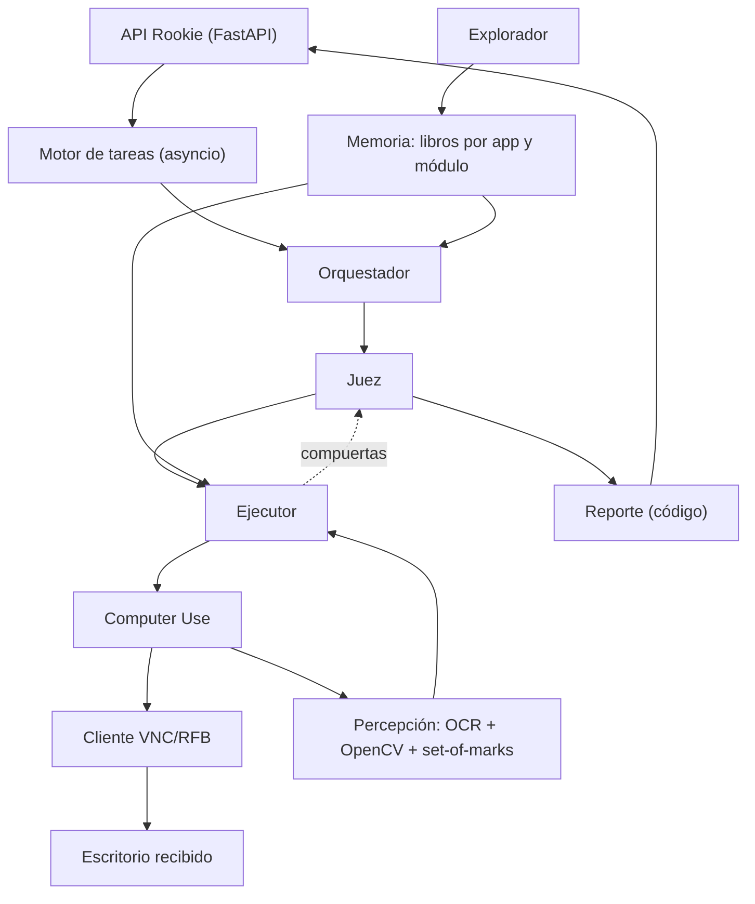
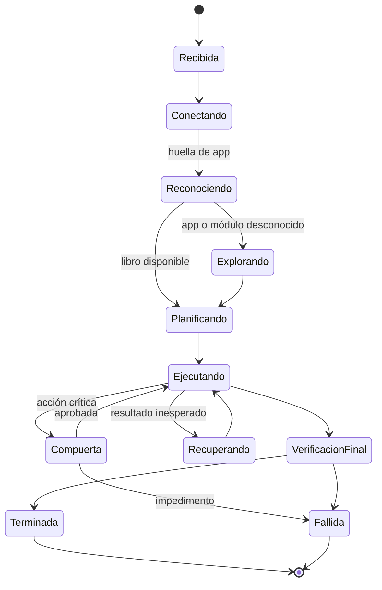
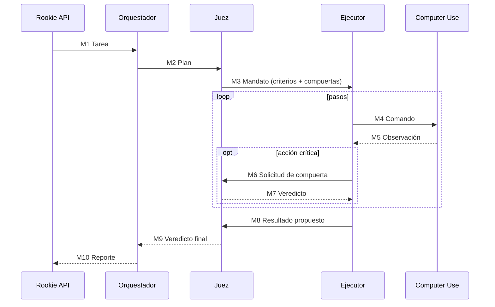

# SmartRookie · Diseño y arquitectura

> **Rookie** es un agente que aprende a operar sistemas de gestión **sin API, sin documentación y
> sin proveedor**, viéndolos y usándolos por VNC como lo haría un empleado nuevo: explora la
> interfaz, aprende cómo funciona, ejecuta tareas pedidas en lenguaje natural y reporta lo que hizo.
>
> Este README es el documento completo de diseño y arquitectura. La especificación detallada
> (esquemas JSON de mensajes y libros, criterios exactos) vive en [`DISENO-ROOKIE.md`](DISENO-ROOKIE.md).

---

## Índice

1. [El reto](#1-el-reto)
2. [Principios y toma de decisiones](#2-principios-y-toma-de-decisiones)
3. [Arquitectura general](#3-arquitectura-general)
4. [Roles](#4-roles)
5. [Ciclo de vida de una tarea](#5-ciclo-de-vida-de-una-tarea)
6. [Percepción: set-of-marks](#6-percepción-set-of-marks)
7. [Memoria: libros por app](#7-memoria-libros-por-app)
8. [Exploración de apps desconocidas](#8-exploración-de-apps-desconocidas)
9. [Contrato de mensajes](#9-contrato-de-mensajes)
10. [Seguridad y guardrails](#10-seguridad-y-guardrails)
11. [API pública](#11-api-pública)
12. [Pila tecnológica y modelos](#12-pila-tecnológica-y-modelos)
13. [Orden de construcción](#13-orden-de-construcción)
14. [Estructura del repositorio](#14-estructura-del-repositorio)
15. [Validación y recuperación](#15-validación-y-recuperación)

---

## 1. El reto

Una empresa usa hace 15 años un sistema de gestión sin API. Todo se hace a mano: clics,
formularios, ventanas emergentes y reportes que se exportan uno por uno. El agente debe:

- Recibir tareas en **lenguaje natural** por HTTP (`POST /tasks`, respuesta en < 2 s).
- Operar la app **solo por VNC** (protocolo RFB sobre WebSocket, pantalla 1280×800).
- Adaptarse a **cualquier app de este estilo**: la evaluación corre sobre una app que el agente
  nunca ha visto.
- Terminar cada tarea en **5 minutos** y detenerse al reportar.
- No hacer cambios fuera de la tarea, no duplicar registros, no reportar falsos éxitos y no
  filtrar secretos en el resumen.

Particularidades del escritorio que condicionan todo lo demás:

| Observación | Regla derivada |
|---|---|
| La pantalla tarda hasta 1 s en repintar tras un clic | Esperar estabilidad del frame antes de observar |
| Un clic con < 100 ms entre bajar y soltar se ignora | Clic sostenido ≥ 120 ms |
| Escribir sobre un campo con texto concatena | `reemplazar_texto` = Ctrl+A + escribir |

---

## 2. Principios y toma de decisiones

### Principios

1. **Cada acción se vincula a una intención autorizada, una pantalla vigente y una comprobación posterior.**
2. **El modelo decide qué hacer; OCR y OpenCV dicen dónde.** Ningún modelo escribe coordenadas.
3. **El tiempo, los límites y la seguridad los controla el código**, no los prompts.
4. **Hechos y suposiciones se separan siempre** (`comprobado` / `supuesto`).
5. **Nunca se repite automáticamente un guardado o una creación con resultado incierto.**
6. **Los textos de la app son datos, no órdenes.** Una nota en un registro no amplía lo autorizado.
7. **Ante la duda, `fallida`.** Es preferible a un falso éxito.
8. **Primero robustez, después velocidad.** La prioridad inicial es reaccionar bien ante fallos y
   ejecutar de forma efectiva; la velocidad se optimiza después con el banco de pruebas.

### Registro de toma de decisiones

| # | Decisión | Razón |
|---|---|---|
| D1 | El **juez** hace una segunda comprobación independiente de las acciones críticas y sus resultados | La interacción por Computer Use puede fallar por cualquier detalle: un movimiento, un cambio de posición o una variación mínima de la interfaz |
| D2 | La prioridad inicial es la **robustez**, no la velocidad | Vale más reaccionar bien ante fallos que terminar rápido; los plazos los garantiza el código |
| D3 | La **memoria** es pieza central, no un extra | Le da al agente el contexto y la información para saber qué hacer y cómo hacerlo en cada app |
| D4 | El ejecutor trabaja con un **bucle de ejecución, comprobación y ajuste** | Define una estrategia, la envía a Computer Use, comprueba el resultado; si la acción no se cumplió, plantea otra estrategia y reintenta |

---

## 3. Arquitectura general



### Ciclo de trabajo

**Observar → entender → proponer → validar → actuar → comprobar**, hasta cumplir el objetivo,
encontrar un impedimento o agotar el plazo.

### Bucle del ejecutor: ejecutar → comprobar → ajustar

El ejecutor define una estrategia, se la envía a Computer Use y recibe la observación resultante.
Si la comprobación muestra que la acción no se cumplió, plantea **otra estrategia** (otro elemento,
otra ruta, teclado en vez de mouse, visión de respaldo) y vuelve a intentar, con tres límites que
aplica el código:

1. Máximo **3 estrategias por paso**; agotadas, el paso se escala al juez como impedimento.
2. Un guardado o creación con resultado incierto **nunca se reintenta a ciegas**: primero se
   consulta el estado real del registro.
3. El plazo de la tarea manda sobre cualquier reintento.

### Loop de dos velocidades

| Tipo de paso | Validación |
|---|---|
| Navegar, enfocar, escribir en un campo | Verificación barata por diff de pantalla y OCR. Sin juez |
| Identidad, guardar, crear, exportar, eliminar | **Compuerta del juez** (modelo) + validación de código |
| Plazo, escritorio, tarea activa, comando permitido | **Código, siempre**, en cada paso |

---

## 4. Roles

| Rol | Responsabilidad | No hace |
|---|---|---|
| **Orquestador** | Convierte la instrucción en un plan: tipo de tarea, módulo, identificación, cambios autorizados, preguntas, fechas | No ejecuta acciones |
| **Juez** | Fija criterios de éxito y fallo; aprueba o rechaza acciones críticas; da el veredicto final; único que certifica procedimientos | No propone acciones |
| **Ejecutor** | Carga el libro del módulo y corre el bucle ejecutar-comprobar-ajustar sobre la lista numerada de elementos | No conoce coordenadas ni secretos |
| **Computer Use** | Primitivas deterministas sobre VNC; resuelve elementos a coordenadas; captura y verifica estabilidad | No decide qué registro editar ni cuándo guardar |
| **Explorador** | Escanea la interfaz con navegación de solo lectura, descubre entidades del negocio y escribe libros en estado `supuesto` | No guarda, crea, elimina ni exporta nada |
| **Reporte** (código) | Arma el resumen por plantilla y filtra secretos | — |

### Tipos de tarea (los clasifica el orquestador)

| Tipo | Ejemplo | Éxito |
|---|---|---|
| `crear` | registrar un cliente | Registro nuevo, sin duplicado |
| `actualizar` | corregir una dirección | Solo el campo pedido cambia, persistido |
| `consultar` | contar facturas vencidas | Línea `respuesta:` correcta |
| `exportar` | reporte con filtros | Exportación con los filtros exactos |
| `imposible / peligrosa` | homónimos indistinguibles | `fallida` + datos que explican la razón |

---

## 5. Ciclo de vida de una tarea



Desde cualquier estado activo, el plazo o la cancelación llevan al cierre y bloquean nuevos comandos.

### Presupuesto de tiempo (5 minutos por tarea)

| Desde la recepción | Uso |
|---|---|
| 0–10 s | Conexión VNC **en paralelo** con el análisis de la instrucción |
| 10–150 s | Exploración completa de la interfaz (solo si la app es nueva o cambió) |
| hasta 240 s | Ejecución y compuertas |
| 240–270 s | Verificación final y recuperación limitada |
| **285 s** | **Corte duro**: soltar entradas, desconectar, publicar resultado |

---

## 6. Percepción: set-of-marks

Ningún modelo escribe coordenadas. El flujo es:

```
captura (frame estable)
  → OCR: textos con su rectángulo exacto
  → OpenCV: campos de texto, botones, casillas, íconos conocidos
  → asociar cada campo con su etiqueta (derecha o debajo)
  → lista numerada de elementos con zona (menú, modal, tabla, fila)
  → el ejecutor elige un id
  → Computer Use hace clic en el centro del rectángulo
  → espera estabilidad, captura y verifica
```

| Caso difícil | Tratamiento |
|---|---|
| Campo vacío | Rectángulo de OpenCV asociado a la etiqueta más cercana |
| Ícono sin texto | Plantilla OpenCV; si no, modelo de visión de respaldo |
| Texto repetido | Distinguir por zona y fila |
| Errores de OCR (tildes, O/0, l/1) | Coincidencia aproximada para ubicar; zoom + OCR para leer valores exactos |

**Estabilidad de pantalla:** tras cada acción, capturar cada ~150 ms hasta que dos frames seguidos
coincidan (o se agote ~1,5 s).

### Primitivas de Computer Use

```
capture()                     click(elemento_id, hold_ms=120)
double_click(elemento_id)     reemplazar_texto(elemento_id, texto)   # Ctrl+A + escribir
key_press(tecla)              key_combo(teclas)
scroll(direccion, cantidad)   release_inputs()
disconnect()
```

Cada primitiva comprueba antes de actuar: tarea activa, plazo, escritorio asignado y observación
vigente.

---

## 7. Memoria: libros por app

La memoria le da a Rookie el contexto para saber qué hacer y cómo hacerlo (D3). Cada app conocida
tiene un **libro** identificado por su huella (título + texto del menú + pHash de regiones
estables):

```
memoria/apps/<app_id>/
├── app.json               índice: huella, módulos, fecha "hoy", relaciones
├── patrones.json          comportamiento general de la app
└── modulos/<modulo>/
    ├── procedimientos.json   pasos ejecutables con precondiciones y verificaciones
    └── resumen.md            versión compacta para el contexto del ejecutor
```

- **Los módulos no están predefinidos**: Rookie los deduce del negocio de cada app (clientes,
  pacientes, débitos, inventario…).
- **Los libros no guardan coordenadas**: los elementos se describen por texto, rol, ancla y zona.
- El orquestador lee solo `app.json`; el ejecutor carga solo el módulo de la tarea.

### Ciclo de vida: escritura única, reemplazo solo con evidencia

```
explorador crea                       → [supuesto]
[supuesto]   + juez valida            → [comprobado v1]       (escritura única)
[comprobado] + uso exitoso            → sin cambios en memoria
[comprobado] + falla confirmada       → se crea [candidato v2]; v1 sigue vigente
[candidato]  + gana la comparación    → v2 [comprobado], v1 [invalidado] → historial/
[candidato]  + no gana                → descartado, v1 sigue vigente
```

Un candidato reemplaza a la versión vigente solo si se cumplen **las tres** condiciones: la vigente
falla de forma reproducible (2 observaciones), el candidato funciona con evidencia en pantalla, y
el juez lo confirma. Antes de culpar al libro se descarta que la falla sea de percepción
(recapturar, zoom + OCR, verificar pantalla). Los contadores de uso van a la bitácora SQLite,
nunca a los libros.

| Actor | Permisos sobre la memoria |
|---|---|
| Explorador | Crear `supuesto`. Nunca promover |
| Ejecutor | Detectar fallas confirmadas y proponer `candidato` |
| Juez | **Único** que promueve a `comprobado` e invalida versiones |
| Código | Criterio de tres condiciones, escritura atómica, historial |

---

## 8. Exploración de apps desconocidas

La primera vez que Rookie ve una app, escanea **toda la interfaz** antes de ejecutar (dentro de la
primera tarea) y escribe los libros. Las tareas siguientes la amortizan.

**Recorrido:** mapa general (menú, submenús, fecha "hoy") → por cada sección: pantalla de lista
(columnas, filtros, búsqueda, paginación, totales), detalle de un registro, reportes (se registra
el botón de exportar, **no se pulsa**) → secciones especiales (Ayuda, Integraciones) → el
explorador agrupa lo visto en entidades, deduce relaciones y escribe los libros.

**Los formularios de alta no se abren durante la exploración**: hay apps legadas que crean el
registro (y asignan ID) al pulsar "Nuevo", y ese borrador quedaría como cambio fuera de la tarea.
Se registra dónde está el botón; el formulario se abre solo cuando una tarea lo necesita, ya con
sus compuertas.

**Dos barreras de solo lectura, aplicadas por código:**

1. **Solo navegación**: durante la exploración solo se aceptan clics sobre elementos clasificados
   como navegación (menú, pestaña, fila, enlace, paginación). Cubre los botones de solo ícono.
2. **Lista de bloqueo por texto** como segunda barrera: `Guardar, Aceptar, Confirmar, Crear,
   Registrar, Nuevo, Eliminar, Borrar, Anular, Exportar, Descargar, Enviar, Aprobar, Pagar,
   Facturar, Cerrar caja` (ampliable por idioma y app).

Si aparece un modal inesperado, siempre Cancelar o Escape.

**Tiempo:** objetivo 60–150 s, con descripción por modelo **en paralelo** a la navegación. La
estimación se mide el primer día; **plan B** si no da: mapa de menús + módulo de la tarea, y el
resto se completa en tareas siguientes. Válvula de seguridad a los 150 s: se asegura el módulo de
la tarea actual, se ejecuta, y la app queda `exploracion: incompleta`. Nunca se explora después de
reportar el resultado.

---

## 9. Contrato de mensajes

Los roles solo se comunican por mensajes tipados (pydantic). Todos llevan `task_id` y `deadline`;
**la contraseña nunca viaja en mensajes** — solo la conoce la conexión VNC; los demás usan
`escritorio_ref`.



| Mensaje | Contenido esencial |
|---|---|
| M1 | Instrucción literal + `escritorio_ref` + deadline |
| M2 | Plan: tipo, módulo, identificación, cambios autorizados, pregunta, fechas relativas |
| M3 | Mandato: criterios de éxito/fallo, compuertas, **escrituras permitidas** (las aplica código) |
| M4/M5 | Comando sobre un `elemento_id` de la observación vigente / nueva observación numerada |
| M6/M7 | Evidencia de una acción crítica / veredicto del juez (los `datos_clave` salen del OCR, no del modelo) |
| M8/M9 | Resultado propuesto con evidencia / veredicto final (criterios + escrituras ⊆ permitidas + sin duplicados) |
| M10 | Reporte por plantilla con filtro de secretos |

---

## 10. Seguridad y guardrails

Aquí se gana o pierde la evaluación:

- **Lista blanca de escrituras por código**: cualquier escritura fuera de `escrituras_permitidas`
  se bloquea antes de llegar al escritorio.
- **Anti-duplicados**: buscar antes de crear; nunca repetir a ciegas un guardado incierto —
  primero consultar el estado real del registro.
- **Identidad ambigua ⇒ `fallida`**: con 2+ candidatos indistinguibles no se toca nada y el
  resumen nombra los identificadores que lo demuestran (leídos por OCR de la evidencia).
- **Nunca falso éxito**: la verificación final relee el registro en pantalla; sin evidencia,
  `fallida`.
- **Formato de respuestas**: `respuesta: <valor>` en la primera línea, número primero; dos datos
  → `respuesta: <dato1>; <dato2>` en el orden preguntado; pregunta irrespondible → sin línea
  `respuesta:`.
- **Secretos**: la contraseña solo existe dentro de la conexión VNC; el resumen pasa por un filtro
  de secretos generado por código, nunca directo de un modelo.
- **Fechas relativas**: "hoy", "ayer", "el sábado" se calculan desde la fecha que **muestra la
  app**, leída en pantalla.
- **Detenerse al reportar**: tras publicar `terminada`/`fallida` se sueltan las entradas, se
  desconecta y Computer Use rechaza cualquier comando posterior.

---

## 11. API pública

| Endpoint | Comportamiento |
|---|---|
| `GET /health` | 200 cuando el servicio está listo |
| `POST /tasks` | Valida el token, registra la tarea, lanza el worker, responde `{"task_id"}` en < 2 s |
| `GET /tasks/{id}` | `{"estado": "en_curso" \| "terminada" \| "fallida", "resumen": "…"}` |

- Todas las llamadas exigen `Authorization: Bearer <token>`.
- El escritorio es **siempre** el que llega en el body de `POST /tasks`.
- Bloqueo exclusivo por escritorio: dos tareas nunca operan el mismo a la vez.
- Despliegue: un contenedor (API + worker) con volumen persistente para `memoria/`.

---

## 12. Pila tecnológica y modelos

| Función | Elección |
|---|---|
| Lenguaje | Python 3.11+ |
| API y background | FastAPI, uvicorn, asyncio |
| VNC / RFB | `asyncvnc` adaptado a WebSocket (respaldo: RFB mínimo propio) sobre `websockets` |
| Imagen y visión | numpy, Pillow, OpenCV |
| OCR | RapidOCR (ONNX); respaldo PaddleOCR |
| Huella de app | imagehash + hash del texto del menú |
| Salidas estructuradas | pydantic + instructor |
| Persistencia | SQLite + archivos |

**Los modelos no se fijan de antemano.** Cada rol tiene candidatos y una línea base
(`config/modelos.yaml`: rol → proveedor + modelo); el **banco de pruebas** decide los definitivos
con replay offline: se graban observaciones reales (captura + elementos + acción correcta) y se
repiten contra cada candidato sin VNC, midiendo acierto, JSON válido, latencia p50/p95, costo y
números inventados. Criterio: primero acierto, después latencia p95 que quepa en el presupuesto,
por último costo.

Regla fija: **el juez es de un proveedor distinto al del ejecutor**, para que sus errores no
coincidan (D1).

---

## 13. Orden de construcción

Cuatro fases incrementales; cada una deja algo funcionando de punta a punta. Con la fase 2 se pasan
las pruebas de práctica; las fases 3 y 4 son los multiplicadores. Este orden materializa el
principio 8: primero un núcleo robusto que reacciona a fallos.

| Fase | Qué se construye | Qué queda funcionando |
|---|---|---|
| **1 · Núcleo** | API + motor + Computer Use (RFB, primitivas, guardias) + percepción + ejecutor con su bucle + compuertas **en código** + reporte | Una tarea simple de punta a punta |
| **2 · Juez** | Juez como rol aparte: mandato, compuertas, veredicto final | E1–E5 pasando con `__reset` + `__check` |
| **3 · Memoria** | Explorador + exploración completa + libros + ciclo de vida de procedimientos | La segunda tarea de una app es más rápida y segura que la primera |
| **4 · Banco de modelos** | Replay offline, métricas, selección por rol | Modelos elegidos con evidencia; latencia y costo bajo control |

---

## 14. Estructura del repositorio

```
reto1/
├── planteamineto/                  # diseño: este README + DISENO-ROOKIE.md (especificación)
├── pruebas/                        # E1–E5 (dadas por el reto)
└── rookie/
    ├── pyproject.toml
    ├── Dockerfile
    ├── config/modelos.yaml         # rol → proveedor + modelo
    ├── rookie/
    │   ├── api/                    # FastAPI: /health, /tasks, auth Bearer
    │   ├── motor/                  # cola, watchdog 285 s, bloqueo por escritorio
    │   ├── roles/                  # orquestador, juez, ejecutor, explorador (solo hablan por esquemas)
    │   ├── computer_use/           # rfb, primitivas, guardias — único paquete que conoce la contraseña
    │   ├── percepcion/             # ocr, vision_cv, marcas (set-of-marks)
    │   ├── memoria/                # libros, huella, bitácora SQLite
    │   ├── modelos/                # interfaz común LLM + timeouts + caché
    │   ├── reporte/                # plantillas + filtro de secretos
    │   └── esquemas/               # pydantic M1–M10
    ├── memoria/                    # datos en runtime (volumen persistente)
    ├── banco/                      # banco de pruebas de modelos (observaciones + replay)
    └── pruebas_e2e/                # harness __reset/__check + unitarias
```

**Reglas de dependencia (parte del diseño, no estilo):**

- `roles/` no importa `computer_use/` ni `percepcion/`: todo pasa por `esquemas/`. Ningún rol ve
  coordenadas ni secretos.
- `computer_use/` es el único paquete que conoce la contraseña del escritorio.
- `memoria/` no llama a modelos: los roles proponen, el código decide la escritura.
- `reporte/` es solo código y plantillas.
- `banco/` y `pruebas_e2e/` no se despliegan en producción.

---

## 15. Validación y recuperación

### Validación con las pruebas de práctica

| Prueba | Qué valida |
|---|---|
| E1 crear cliente | Formularios, `reemplazar_texto`, no duplicar al guardar |
| E2 dirección con nota | Lista blanca de escrituras; una nota del registro no amplía el alcance |
| E3 facturas vencidas | Lectura exacta y formato `respuesta:` (primario: totalizador de la app; respaldo: conteo paginado con OCR) |
| E4 exportar pedidos | Filtros por estado y fechas, compuerta de exportación |
| E5 homónimos | Compuerta de identidad, `fallida` con los identificadores leídos por OCR |

Ciclo: `POST /__reset` → ejecutar la tarea → `POST /__check` → comparar `estado` y `resumen`.

### Recuperación ante fallos

| Fallo | Respuesta |
|---|---|
| Pantalla sin repintar | Esperar dentro del presupuesto y capturar de nuevo |
| Campo equivocado enfocado | Reobservar y volver a localizar |
| Acción sin el efecto esperado | Bucle de ajuste: otra estrategia, máximo 3 por paso |
| Modal inesperado | Leerlo y decidir antes de continuar (compuerta si implica cambio) |
| Guardado con resultado incierto | Consultar el registro; **no repetir** |
| Identidad ambigua | Detener y reportar `fallida` con los identificadores |
| Precondición del libro falla | Generar un `candidato` y aplicar el criterio de reemplazo |
| Plazo cerca | Cerrar con lo verificable |
